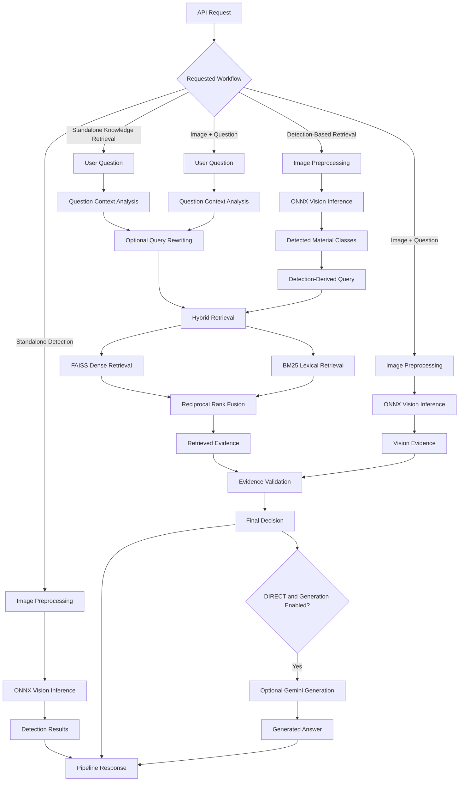

# Smart Waste Multimodal AI

An evidence-based multimodal system for waste detection and recycling knowledge retrieval. It combines YOLO-based image detection, hybrid information retrieval, evidence validation, and optional LLM-based answer generation in a modular pipeline exposed through a FastAPI service.

The system supports four primary workflows: **Standalone Detection**, **Standalone Knowledge Retrieval**, **Detection-Based Retrieval**, and **Image + Question**. A bilingual web frontend (English and Persian) provides access to these workflows. Answer generation is an optional stage that can use validated evidence when the request and final decision permit it.

## Core Workflows

### 1. Standalone Detection

Detects waste materials in an input image without running knowledge retrieval.

- Accepts an image.
- Applies image preprocessing.
- Runs ONNX-based object detection.
- Returns detected material classes, confidence scores, and bounding boxes.

This workflow does not require a retrieval query or a knowledge-generation step.

### 2. Standalone Knowledge Retrieval

Retrieves recycling-related information directly from a user's question, without running image detection.

- Accepts a natural-language question.
- Uses the question as the retrieval query.
- Can optionally use API-assisted query rewriting to improve the retrieval query.
- Retrieves relevant knowledge using dense and lexical search.
- Combines rankings with Reciprocal Rank Fusion (RRF).
- Passes retrieved evidence through the evidence and final-decision stages.

This workflow does not require an image.

### 3. Detection-Based Retrieval

Uses image detection results to retrieve recycling knowledge about the detected materials.

- Accepts an image.
- Runs the vision pipeline.
- Extracts the detected material classes.
- Builds a retrieval query from those classes.
- Retrieves supporting knowledge using hybrid retrieval.
- Validates evidence and applies the final decision process.

For example, an image containing plastic and glass objects can produce a retrieval query based on the detected classes.

This workflow connects visual recognition to knowledge retrieval without requiring the user to manually provide the material names.

Detection-derived queries bypass question-based query rewriting. Retrieval is not executed in this workflow if Vision produces no detections.

### 4. Image + Question

Combines image understanding with question-based recycling knowledge retrieval.

- Accepts an image and a natural-language question from the user.
- Runs the Vision pipeline on the uploaded image.
- Uses the user's question as the retrieval query.
- Does not replace the user's question with detected material classes.
- Runs question context analysis and optional query rewriting.
- Registers Vision and Retrieval evidence for the shared evidence-validation and final-decision process.
- Can optionally generate an answer when the final decision and evidence context permit it.

This workflow is useful when the user wants to ask a specific question about an uploaded image. For example, the user can upload an image containing several waste materials and ask how to separate or recycle a particular item.

The image provides additional visual evidence, while the user's question remains the source of the retrieval query.

## Query Rewriting

The question-based retrieval pipeline supports optional API-assisted query rewriting.

When a query rewriting service is configured, it can use a language-model API to improve the original question for knowledge retrieval. The purpose is to produce a retrieval-oriented query while preserving the user's original question as the source of truth.

The rewriting process is selective rather than mandatory:

- The original question is used directly when rewriting is not configured or is bypassed.
- A rewritten query can be used when the rewriting service returns a valid result.
- If rewriting fails, the system can fall back to the original question.
- The rewriting outcome is recorded through a query rewrite trace.

Query rewriting applies to question-based retrieval. Detection-derived queries bypass this service because they are constructed directly from the detected material classes.

## Optional Answer Generation

The system can optionally generate a natural-language answer using the validated evidence produced by the pipeline.

Generation is not required for any of the four workflows. It is executed only when:

- Answer generation is enabled in the request.
- Context and evidence validation do not block execution.
- The final decision is `DIRECT`.
- A final evidence context is available.
- A Gemini API key is configured.

The generation stage uses the final evidence context rather than bypassing the evidence-based decision process.

If generation is requested but the required Gemini API key is unavailable, the API rejects the request.

## Architecture Overview



## Technology Stack

| Area | Technologies |
|---|---|
| Language | Python 3.11+ |
| API | FastAPI, Uvicorn |
| Object Detection | YOLO-compatible ONNX model |
| Inference | ONNX Runtime |
| Image Processing | OpenCV, NumPy, Pillow |
| Text Embeddings | Sentence Transformers |
| Embedding Model | `intfloat/multilingual-e5-small` |
| Dense Retrieval | FAISS |
| Lexical Retrieval | BM25 |
| Rank Fusion | Reciprocal Rank Fusion (RRF) |
| LLM API Integration | Optional API-assisted query rewriting and Gemini-based answer generation |
| Validation | Pydantic |
| Testing | pytest |
| Code Quality | Ruff |
| Deployment | Docker, Docker Compose |

## Retrieval Pipeline

The knowledge retrieval component combines two complementary retrieval methods:

- **Dense retrieval:** multilingual text embeddings generated with `intfloat/multilingual-e5-small` and searched through FAISS.
- **Lexical retrieval:** BM25-based keyword matching.

The two ranked result lists are combined using Reciprocal Rank Fusion.

The E5 encoder uses the expected prefixes:

- `query:` for search queries.
- `passage:` for indexed documents.

Embeddings are normalized before indexing and search.

The retrieval adapter supports both question-based queries and queries derived from detected material classes. Detection-derived queries bypass question-based query rewriting.

## Evidence-Based Decision Process

Retrieved and vision-derived information is handled through explicit evidence contracts and validation stages.

The final decision process supports three actions:

- `DIRECT` — sufficient validated evidence is available for a direct response.
- `INSUFFICIENT_EVIDENCE` — the available evidence does not support a direct response.
- `HUMAN_REVIEW` — additional clarification or human review is required.

Optional answer generation is gated by the final decision and receives the final evidence context.

## API

The application exposes a FastAPI service.

### Endpoints

| Method | Endpoint | Description |
|---|---|---|
| GET | `/health` | Health check |
| POST | `/api/v1/conversations` | Create a conversation |
| POST | `/api/v1/conversations/{conversation_id}/analyze` | Analyze a request |
| POST | `/api/v1/conversations/{conversation_id}/close` | Close a conversation |
| DELETE | `/api/v1/conversations/{conversation_id}` | Delete a conversation |

Interactive API documentation is available at:

`http://127.0.0.1:8000/docs`

### Analyze Request

The analyze endpoint accepts multipart form data:

| Field | Description |
|---|---|
| `request_id` | Request identifier |
| `task_type` | `detection` or `knowledge_question` |
| `question` | Optional natural-language question |
| `locale` | Response locale: `en` or `fa` |
| `options` | JSON-encoded request options |
| `image` | Optional JPEG or PNG image, up to 15 MiB |

The request options control which pipeline stages are executed.

For example, the deployment configuration documents these two independent modes:

**Standalone Detection**

```json
{
  "run_vision": true,
  "run_retrieval": false,
  "generate_answer": false,
  "retrieval_query_source": "question"
}
```

**Standalone Knowledge Retrieval**

```json
{
  "run_vision": false,
  "run_retrieval": true,
  "generate_answer": false,
  "retrieval_query_source": "question"
}
```

Detection-Based Retrieval uses both Vision and Retrieval, with the retrieval query derived from the vision results.

**Image + Question**

```json
{
  "run_vision": true,
  "run_retrieval": true,
  "generate_answer": false,
  "retrieval_query_source": "question"
}
```

In this mode, include both the `image` and `question` multipart fields. The user's question is used for retrieval, while Vision results provide additional evidence for validation and the final-decision process.

## Frontend

The repository includes a lightweight web frontend implemented with HTML, CSS, and JavaScript.

The frontend provides:

- English and Persian interface options.
- Access to all four workflows.
- Image upload and preview.
- A question field for question-based retrieval, including Image + Question.
- Controls for optional answer generation.
- Conversation creation, closing, and deletion.
- API connection status and analysis feedback.

### Frontend Components

| File | Responsibility |
|---|---|
| `frontend/index.html` | User interface structure |
| `frontend/style.css` | Frontend styling |
| `frontend/app.js` | UI logic, localization, and API communication |
| `frontend/dev_server.py` | Local frontend server and API proxy |

The frontend and backend are started as separate local services. Follow the installation and run instructions in [Getting Started](#getting-started).
## Getting Started

### Requirements

- Python 3.11 or newer.
- Docker Engine and Docker Compose for container deployment.
- The ONNX model at `exports/best.onnx`.
- The retrieval index and chunk data under `data/retrieval_index/v4_expanded/`.

The model and retrieval assets must be available at the paths shown above before running the application.

### Local Installation

Clone the repository and enter the project directory:

```bash
git clone https://github.com/samanglz/Smart-Waste-MultimodalAI.git
cd Smart-Waste-MultimodalAI
```

Create a virtual environment:

```bash
python -m venv .venv
```

Activate the virtual environment for your operating system.

**Windows PowerShell:**

```powershell
.venv\Scripts\Activate.ps1
```

If script execution is blocked by the current PowerShell policy, you can allow activation for the current terminal session:

```powershell
Set-ExecutionPolicy -Scope Process -ExecutionPolicy Bypass
.venv\Scripts\Activate.ps1
```

**Windows Command Prompt:**

```cmd
.venv\Scripts\activate.bat
```

**Linux and macOS:**

```bash
source .venv/bin/activate
```

Upgrade pip and install the core project dependencies:

```bash
python -m pip install --upgrade pip
python -m pip install -e .
```

This installs the runtime dependencies declared in `pyproject.toml`, including FastAPI, Uvicorn, ONNX Runtime, Sentence Transformers, FAISS, and the image-processing libraries.

### Optional Dependencies

**Gemini answer generation**

The application can run without Gemini integration. To enable the optional answer-generation capability, install the generation extra:

```bash
python -m pip install -e ".[generation]"
```

Configure either `GEMINI_API_KEY` or `GOOGLE_API_KEY` in the backend environment before sending requests that require Gemini-backed functionality.

**Development and testing tools**

To install pytest and Ruff:

```bash
python -m pip install -e ".[dev]"
```

These development dependencies are not required for normal application execution.

### Environment Configuration

Review `.env.example` for the available configuration variables.

For local execution, make the required environment variables available to the backend process.

| Variable | Purpose |
|---|---|
| `SMART_WASTE_ACTOR_ID` | Backend-configured actor identity |
| `GEMINI_API_KEY` | Optional Gemini API key |
| `GOOGLE_API_KEY` | Alternative Google API key |
| `GEMINI_MODEL` | Optional Gemini model override |

A Gemini API key is not required to start the application. It is required for requests that use Gemini-backed functionality.

### Run Locally

Start the backend from the project root directory:

```bash
python -m uvicorn smart_waste_multimodal.api.main:app --host 127.0.0.1 --port 8000
```

Open a second terminal, navigate to the project root directory, activate the same virtual environment, and start the frontend development server:

```bash
python frontend/dev_server.py
```

Open the application in your browser:

http://127.0.0.1:8080

The frontend development server uses Python's standard library and forwards API requests to the backend at `http://127.0.0.1:8000`.

The backend and frontend must both be running while using the local web application.

The API documentation is available at:

http://127.0.0.1:8000/docs

### Docker Deployment

Configure the environment as required, then build and start the application:

```bash
docker compose up --build -d
```

Check the service:

```bash
curl http://127.0.0.1:8000/health
```

Open the API documentation:

http://127.0.0.1:8000/docs

The Compose configuration binds the service to `127.0.0.1:8000` by default.

For further deployment details, see [DEPLOYMENT.md](DEPLOYMENT.md).
## Testing and Code Quality

Run the test suite:

```bash
pytest
```

Run Ruff:

```bash
ruff check .
```

The repository includes unit and integration tests covering pipeline orchestration, adapters, evidence handling, retrieval, vision processing, API workflows, and failure scenarios.

Test results depend on the current code and environment; consult the latest test run rather than assuming a historical result represents the current state.

## Project Structure

```text
.
|-- data/
|   `-- retrieval_index/
|-- docs/
|-- experiments/
|   `-- evaluation/
|-- exports/
|-- frontend/
|   |-- app.js
|   |-- dev_server.py
|   |-- index.html
|   `-- style.css
|-- src/
|   `-- smart_waste_multimodal/
|       |-- adapters/
|       |-- api/
|       |-- contracts/
|       |-- embeddings/
|       |-- evidence/
|       |-- generation/
|       |-- indexing/
|       |-- orchestration/
|       |-- retrieval/
|       `-- vision/
|-- tests/
|   |-- integration/
|   `-- unit/
|-- .env.example
|-- docker-compose.yml
|-- Dockerfile
|-- DEPLOYMENT.md
`-- pyproject.toml
```

## Runtime and Security Notes

- Conversation and related runtime state are stored in memory.
- Runtime state is lost when the application process or container restarts.
- Conversations remain active until explicitly closed or deleted; there is no automatic expiration.
- The default Docker Compose configuration binds to localhost.
- The configured actor identity is supplied by the backend environment, not by the client request.
- The default deployment is intended for local, single-user use. Do not expose the service to an untrusted network without adding appropriate authentication, authorization, and deployment safeguards.

## Project Scope

The project brings together four independently selectable workflows: standalone visual detection, standalone knowledge retrieval, detection-based retrieval, and image-plus-question analysis. They share a common orchestration and evidence-validation architecture.

API-assisted query rewriting can improve question-based retrieval, while answer generation remains an optional downstream capability rather than a prerequisite for detection or retrieval.

The repository also includes a bilingual local web frontend, evaluation experiments, and supporting documentation for the system's development.
